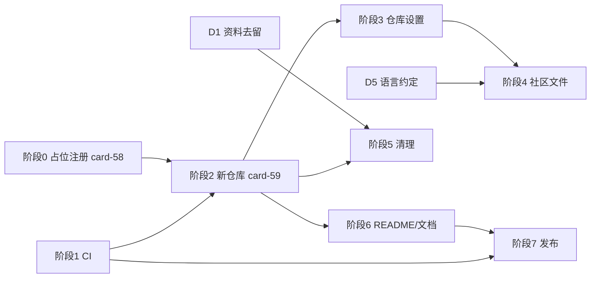

# 开源化改造：从个人开发仓库到可参与的项目

> 相关：[[19-ClawHub发布流程]]（发布执行细节，英文）、[[18-多宿主架构]]（格式版本门控）、[[16-文件存储改造]]、[[15-上游2026.9.4差异评估]]（信任门）
> 状态：全部决策已定（2026-10-14，含新增 D7「手改边界」，见第三节）。改名与换仓库（阶段 0/2）已整体移交卡片（card-58 / card-59）；阶段 1（CI）已落地（`.github/workflows/ci.yml`，本地七步全绿，待推 GitHub 验证）；阶段 5 只剩其余本机路径清理

## 一、背景

按「别人想用 / 想参与 / 想放心依赖」三个视角对仓库做了一次静态审计，结论：代码工程质量高（621 个测试、双进程并发测试、格式版本门控、命名隔离守门），但**项目治理层是缺的**——没有 CI、没有社区文件、个人环境事实与内部过程资料都在公开历史里。审计清单 13 条，逐条核实结果见第二节。

目标不是「变成标准开源项目」，而是：**让外部人能用上、能改、遇到破坏性变更时有据可查**。达到这个目标的最小改动集是 CI + 社区文件 + 路径清理 + 发布跑通；文档国际化与内部资料去留是需要权衡的放大器。

## 二、现状核实（2026-10-14，对审计清单逐条验证）

| # | 审计说法 | 核实结果 | 细节修正 |
| --- | --- | --- | --- |
| 1 | 没有任何 CI | ✅ 属实 | 无 `.github/`；621 个测试只在开发机跑 |
| 2 | 缺社区文件 | ✅ 属实 | CONTRIBUTING / SECURITY / CODE_OF_CONDUCT / CHANGELOG / issue 与 PR 模板全缺；有 `v0.1.0`、`v0.1.1` 两个 tag，当前 0.2.0 未打 tag |
| 3 | 核心文档中文且混在数据目录 | ✅ 基本属实 | 41 篇 736K（审计说「约 40 篇近 1MB」）。**修正**：README 链接的 [[19-ClawHub发布流程]] 本身是英文，但位于 `.taskfold/documents/需求/` 下，URL 编码后是一串 `%E9%9C%80...`，对英文读者是坏体验 |
| 4 | 约 27 个已跟踪文件含本机路径/身份 | ⚠️ 数字不准 | **含本机环境事实（`/home/john` 或 `openclaw.local`）的 18 个**：需求文档 12 篇、`AGENTS.md`、`VERIFICATION.md`、`scripts/backfill-procloud-m3.mjs`、3 个测试文件；其中含 `/home/john` 硬路径的 17 个。另有 8 个文件只含 `johnson9316-bit`（包名/license/URL），那是公开身份不是泄漏 |
| 5 | 内部过程资料在仓库里 | ⚠️ **有意保留，不是缺口**（2026-10-14 用户拍板） | 一半是自用工作卡片（dogfooding 的活证据），一半是「本项目自带例子」——`.taskfold/` 的数据与资料库文档本身就是这个工具的示例现场。仍待确认：[[22-状态模型]] 里有真实公司项目名与卡数（vmcloud 42 卡、procloud 81 卡） |
| 6 | `.claude/skills`、`CLAUDE.md` 入库 | ✅ 属实 | `.claude/skills/delegate` 2 个文件 + `CLAUDE.md` + `AGENTS.md`（后者含大量本机环境事实：Gateway 地址、token 读取方法、数据库路径） |
| 7 | 强绑定 OpenClaw 且钉死版本 | ⚠️ **部分成立，属有意取舍** | 措辞修正：`dependencies` 里没有 openclaw（宿主运行时提供）；精确 `2026.9.4` 是 `devDependencies` 里的**开发基线**，对外声明的是 peer 范围 `>=2026.7.1 <2027.0.0`。架构已多宿主（[[18-多宿主架构]]：OpenClaw/VS Code 先行，以后还有 dsh/pi），但**执行能力目前只有 OpenClaw 适配层一份**（VS Code 无执行、dsh/pi 未接）；另有 fork 后不同步上游、信任门（[[15-上游2026.9.4差异评估]]）两条上游约束。处置是文档义务（写明兼容范围与各宿主能力矩阵），不是代码待办 |
| 8 | 发布渠道未跑通 | ✅ 属实 | README 原文 "After the package is published"；`git:` 安装已明确不可用；VS Code 扩展要手打 vsix |
| 9 | 包 `private: true`、个人 scope | ✅ 属实 | `@johnson9316-bit/taskfold`（个人 scope）；`@taskfold/cli`、`@taskfold/core`、`@taskfold/ui` 是 `private: true`；LICENSE 版权人是 johnson9316-bit |
| 10 | Node 24 硬门槛 | ⚠️ 比审计说的更严重 | 硬门槛属实：全部 `package.json` 的 `engines.node >=24.16.0`、`.nvmrc` 24.21.0，源于上游 openclaw 的 preinstall 硬要求。**但根 README:61 的 Requirements 写的是 `Node.js \`>=22\`**——照它用 Node 22 装会当场失败；`packages/cli/README.md` 的「Node 22」指产物运行要求（esbuild target node22），语境不同、本身没错，两处放一起容易误读 |
| 11 | LICENSE 合规小问题 | ✅ 属实 | `THIRD-PARTY-NOTICES` 未贴 OpenClaw 的 MIT 版权声明**全文**；bundle 进 `dist/` 的依赖不止列的 4 个（漏 `proper-lockfile`、`typebox`、`@antv/g6`、`@milkdown/kit` 及其传递依赖、`dompurify`、`marked` 等） |
| 12 | 格式升级单向、无对外说明 | ✅ 属实 | 当前 `TASKFOLD_FORMAT_VERSION = 4`（v2 里程碑、v3 图片、v4 状态模型）；回退无路径；README 只在「Markdown Storage」里一句带过 v2/v3，v4 完全没写 |
| 13 | README 过载 | ✅ 属实 | 260 行、11 个二级标题，插件功能／宿主设置／SQLite 迁移／VS Code／CLI 混在一起 |

## 三、决策点

> 每个决策点先写**实质**（绕不开的权衡），再给选项、推荐与理由。**八个决策点均已于 2026-10-14 拍板**，汇总见本节末尾；无待决项。

| # | 决策点 | 实质 | 状态 |
| --- | --- | --- | --- |
| D0 | 目标形态（上位） | 要用户、要贡献者，还是要合作者 | **已定：B/C（完全开源）** |
| D1 | 内部资料去留 | 哪些内容算「项目的一部分」 | **已定（2026-10-14 修订）：全部保留**——卡片与过程资料都是「自带例子」 |
| D2 | 英文文档供给 | 翻译是给谁看的 | **已定：不翻译（按需）** |
| D3 | 包名与 scope | 与产品名同进同出 | **已定：选项②**（专包无 scope + 内部包用 scope） |
| D4 | 兼容性承诺 | 承诺边界写多硬 | **已定：新开仓库，不做迁移/回退工具** |
| D5 | 对外语言 | 谁读提交历史与注释 | **已定：保持中文 + CONTRIBUTING 声明** |
| D6 | 产品名与命名空间 | 起一个恰当且未被占用的名字 | **已定：`kanbanfile`**（改名 + 新开仓库） |
| D7 | 手改数据文件 | 文件化看板的「文件可改」边界 | **已定：支持手改**——AI 走 CLI / 工具，人工可直接编辑文件；规则统一在 `docs/format.md` |

### D0 目标形态（上位问题）

| 形态 | 投入重点 | 对 D1/D2/D5 的影响 |
| --- | --- | --- |
| A 只要用户能用 | 安装路径（ClawHub 一行命令）、README、报错信息 | D1 可放心挪走过程资料；D2 不翻译；D5 语言随意 |
| B 要有人提 PR | 架构文档 + 能读懂代码的语言 | D1 必留架构文档；D2 要考虑翻译；D5 英文更友好 |
| C 要有人共同维护 | B + 治理（决策记录、路线图、issue 分类、review 流程） | D2 从可选变必需 |

**B/C 必须先正视的矛盾**：代码注释是中文的（几千处，术语自成体系）。只懂英文的人读了英文设计文档也**改不动代码**——所以 B/C 有个隐含前提：贡献者需要能读中文，或者你打算把注释也逐步国际化（另一个数量级的工程）。

**已定（2026-10-14）：B/C——完全开源，接受并合并外部 PR，也响应社区需求。**

对后续决策的锁定：

- **D1 走分层（B 方案）**：既然会有人读代码、提 PR，「为什么这样设计」的架构文档必须留在公开仓库，不能全挪走。
- **D2 仍需翻译，但按需**：英文读者要能参与，但翻译次序应由真实提问驱动（他问哪篇翻哪篇），避免投机翻译后无人使用。
- **D5 要额外加一条**：既然接受中文/英文 PR，CONTRIBUTING 要写明「提交信息与评论可用任意语言」，并给 PR 模板加中英双语提示。
- **配套项（新增到阶段 4）**：`good first issue` 标签、issue 模板里问清「是否愿意提 PR」、CONTRIBUTING 写明反馈预期（如「尽力一周内回」）。

### D1 内部资料去留（写清楚版）

问题拆成**两层**，一层是「新公开仓库里放什么」，另一层是「不放的那些去哪」。**（2026-10-14 修订：第二层作废——全部保留。）**

#### 第一层：内容分层（新仓库里放什么）

仓库里现在混着两类东西：「产品本体」与「你的工作过程」。逐类判断：

| 内容 | 判断 | 理由 |
| --- | --- | --- |
| 代码、测试、README、LICENSE | 留 | 产品本体 |
| **架构类设计文档**（5 技术架构、16 文件存储、18 多宿主、22 状态模型、15.7/15.8/15.9 技术设计） | **留** | 它们是「为什么这样设计」的唯一记录，代码注释大量引用；D0 选了 B/C（会有人读代码），不能挪 |
| **卡片 57 张**（244K） | **留** | 「自己用自己」的活证据 + 最好的数据格式样本；含内部项目名的 1 张（vmcloud/procloud）待确认 |
| `CLAUDE.md` | 留 | 「如何用 AI 开发这个项目」的展示，对 AI 时代的贡献者是加分项 |
| 过程类文档：UI/UX 评审（20/21）、上游评估（15/15.10）、竞品调研（12）、目录规范（17）、交接（11）、路线图与需求（1/2/3/4/7/8.x） | **留**（2026-10-14 修订） | 用户拍板：这是「本项目自带例子」——`.taskfold/` 的数据与资料库文档本身就是工具的活示例现场；暴露内部节奏是可接受的代价 |
| `reports/`（120K，含 100K JSON） | **留**（2026-10-14 修订） | 同属「自带例子」（工具输出样本） |
| `VERIFICATION.md`（28K） | **留**（2026-10-14 修订） | 真实使用与验证记录，同属「自带例子」；只增台账、结论可能过时，保留该性质说明即可 |
| `AGENTS.md` | **拆** | 不是「暴露内部」而是**安全情报**：含本机 Gateway 地址与自签证书、插件加载路径、四份历史数据库路径、token 读取方法 |

#### 第二层：挪走的资料去哪 —— **2026-10-14 作废**

用户看过第二节审计后修订 D1：**不挪走，全部保留在公开仓库**。理由就是第 5 条里用户自己的表述——「一半是我工作的卡片，一半是因为本项目是自带例子」。文件化看板的仓库本身就带一份活的数据现场，比任何示例工程更有说服力；这些文档还是高频更新的活资料，不是存档。

（原「① 私有仓库 / ② 留本地不入库 / ③ 删除」三种去处比较随此作废，不建私有归档仓库。）

### D2 英文文档供给

**实质**：翻译是给谁看的？若 D0 选 A，答案很清楚——**不翻译**（在没有英文读者的前提下翻译是投机）。若选 B/C，也别忘了 D0 里的矛盾：文档翻译不解决注释中文的问题。

| 方案 | 内容 | 何时该选 |
| --- | --- | --- |
| A 翻译精选 | 4～6 篇架构类（5 技术架构、16 文件存储、18 多宿主、22 状态模型）翻成英文进 `docs/`，中文原稿留 `需求/` 作真相源 | D0 选 C，或已出现英文 issue |
| B 双语目录 | `docs/en/` + `docs/zh/` | 不推荐：双份维护、必然漂移 |
| **C 先不翻译（推荐）** | README 写明 "Design notes are in Chinese; English summaries on request"，靠 README 与代码注释撑 | D0 选 A/B |

**推荐 C**：按需翻译优于投机翻译。真要翻时，目标也该由第一个真实英文读者决定——他问哪篇，翻哪篇。

**已定（2026-10-14）：C 先不翻译。**

### D3 包名与 scope

**与 D6 同进同出，不单独定**。定名后有三个可选项（推荐②）：

| 选项 | 内容 |
| --- | --- |
| ① 全用无 scope 名 | 发布包 `<名字>`，内部包改 `<名字>-core` 之类——丢失命名空间隔离 |
| ② **专包无 scope + 内部包用 scope（推荐）** | 发布包 `<名字>`（用户装的东西越短越好）；内部 `private: true` 的包改 `@<名字>/core` 等 |
| ③ 全用 scope | 全部 `@<名字>/*`——统一，但用户要打 `openclaw plugins install @<名字>/<名字>` |

**已核实（以 4.6 各候选的行为准）**：本次入决赛的四个名字在 npm 无 scope 名、GitHub 组织名、ClawHub、`.io`/`.dev` 域名上全部空闲，搜索也都干净；npm 组织名是否可注册只能到注册时才知道（无法用 API 查归属，但 `npmjs.com/org/<名字>` 无页面即可试注）。

### D4 兼容性承诺与迁移方式

**已定（2026-10-14）：不进旧仓库原地改名、不做迁移工具、不做回退工具。直接新开一个仓库，旧仓库归档后删除。**

这个决定把三件事一次性解决：

| 问题 | 新开仓库怎么解决 |
| --- | --- |
| 改名（产品名/包名/插件 id/数据目录） | 新仓库从第一个 commit 就用新名字；没有「改旧标识」这回事 || git 历史里的本机路径、内部项目名 | **新历史里根本不存在**——不用 filter-repo 重写（原计划第八节的最大风险项自动消失） |
| 格式版本迁移工具 / 回退工具 | 没有存量外部用户，不需要为别人写迁移工具；你自己的三个项目后续用一小段手工步骤处理（见 card-59） |

关于「兼容性承诺」本身：**仍然保留格式版本门控**（「旧客户端对新格式只读」这个机制值得留，将来多机版本不一致时它保护数据），但 README 里只需一节简短说明，不立承诺、不做工具。迁移前自动备份与幂等重跑继续保留（这两项是既有代码行为，不额外开发）。

**旧仓库处理**：先去 GitHub 把 `johnson9316-bit/Taskfold` 设为 **archive**（只读，可逆），等新仓库发完第一个版本、确认无遗漏后再 **delete**。不直接删——留下一个可逆窗口。

### D5 对外语言约定

| 项 | 现状 | 推荐 | 理由 |
| --- | --- | --- | --- |
| 提交信息 | 全中文，质量高 | **保持中文** | 提交历史的主要读者是你自己与 AI（做 git 分析）；外部贡献者主要看 PR 描述与代码。改英文的成本 > 收益，且会与既有历史割裂 |
| 代码注释 | 中文，术语统一 | **保持中文** | 全转英文是数量级工程；且与 `需求/NN` 文档体系绑定 |
| CONTRIBUTING | — | 加一句「提交信息与评论可用中文或英文」 | 让外部贡献者不被语言卡住 |
| README / 用户文档 | 英文 | 保持英文 | 面向使用者 |

**推荐**：不为「显得国际化」改语言；只补 CONTRIBUTING 的声明。这条可逆——将来真有英文贡献者抱怨，再调整不难。

**已定（2026-10-14）：按推荐执行（保持中文 + CONTRIBUTING 声明）。**

### D6 产品名与命名空间

`Taskfold` 与另一个活跃项目重名（见第四节），对方就在 AI 编码代理生态里，且占着路线图上的 DSH 宿主。**已定（2026-10-14）：改名，并采用「新开仓库」方式（与 D4 同一决定）。**

**新名已定：`kanbanfile`**（2026-10-14 用户拍板）。核查结果：npm 名 / npm 组织页 / GitHub 组织名 / ClawHub 全空；**`.com`、`.io`、`.dev`、`.sh` 四个域名全未注册**（`.com` 经 rdap.org 与 Verisign 官方 RDAP 双重交叉验证）；精确搜索只碰到一个 Obsidian 插件源码里的 `kanbanFile.ts` 文件名；**商标零结果**（无同名注册；且 `KANBAN` / `KANBAN TOOL` 两件相关商标都在 Supplemental 补充注册簿，见 4.6）。

两点提前说清楚（不是反对，是让你心里有数）：

1. **名字含通用词，所以我们自己商标不能注册**——这是选择描述性名字的代价（好处是没人可能起诉我们）。
2. **`file` 是单数，而数据实际上是多文件**（每张卡一个 md）——可比的先例是 go-task 的 `Taskfile`（同样单数，指代一组任务定义），说明这不影响理解。

改名清单与执行步骤已整体移交 card-59（本文不再重复）；新开仓库无存量用户，三个自有项目手工处理即可。

### D7 手改边界（2026-10-14 新立）

审计视角认为「文件化卖点（数据是你的 Markdown）」与「禁止手改」互相矛盾，提议二选一：工具独占，或定义可手改子集。**用户否决了前提**——看板本来就是 AI 能改、人工也能改，不存在「只能走工具」这回事。

核实后，技术上本就支持手改；原来那句「Never … by hand」只是保守的 AI 侧写入建议，不是事实约束：卡片正文手改会被 contentHash 检测、revision 递进（`test/file-store-runtime.test.ts` #1：手改后持旧 revision 的写入判 CONFLICT，不静默覆盖）；`created_date` 手改有明确的「以文件为准」规则；状态不在状态集里的卡在 UI 单列而不消失；`config.yml` 改坏报明确错误。

**已定：手改是一等支持的路径。** 落点：

- 规则统一写进新增的 `docs/format.md`（「Editing files by hand」一节，三档：自由改 / 小心改 / 勿动）。
- CLI 注入块与 `taskfold instructions` 的绝对措辞同步放宽：AI 仍必须走 CLI（跨进程锁 + revision 是并发正确性的前提），人工手改写明边界。
- 长尾（记录，不强求）：手改场景变多时，可考虑 `doctor` / `repair` 命令与手改后的一致性提示。

### 决策状态汇总

| 决策点 | 状态 |
| --- | --- |
| D0 目标形态 | ✅ **已定 B/C**：完全开源，接受并合并外部 PR，响应社区需求 |
| D1 内部资料去留 | ✅ **已定（2026-10-14 修订）：全部保留**（卡片 + 过程文档 + `reports/` + `VERIFICATION.md` 都算「自带例子」）｜两处例外已闭环（第九轮）：`AGENTS.md` 本机部分拆到未跟踪的 `AGENTS.local.md`；vmcloud/procloud 确认为测试项目、名字已删 |
| D2 英文文档 | ✅ **已定：不翻译**（按需） |
| D3 包名与 scope | ✅ 已定选项②（专包无 scope `kanbanfile` + 内部包 `@kanbanfile/*`） |
| D4 兼容性与迁移 | ✅ **已定：新开仓库**，不做迁移/回退工具 |
| D5 对外语言 | ✅ **已定：保持中文** + CONTRIBUTING 声明 |
| D6 产品名 | ✅ **已定：`kanbanfile`**（新开仓库、六项检查全通过） |
| D7 手改边界 | ✅ **已定（2026-10-14）：支持手改**——AI 必须走 CLI（锁 + revision），人工可直接编辑文件；规则见 `docs/format.md`，CLI 文案已同步放宽 |

**全部决策已定。** 阶段 0 与阶段 2 已整体移交卡片（card-58 / card-59），执行清单随卡走；阶段 1（CI）已落地（见第九轮）。

## 四、命名调研（2026-10-14，公开数据核对）

问题：`Taskfold` 会不会显得外行？查了三类数据：注册表占用、同生态重名、品牌资源。

### 4.1 占用与冲突

| 位置 | 结果 | 备注 |
| --- | --- | --- |
| npm 无 scope 名 `taskfold` | **空闲**（registry 返回 404） | 可注册，但见 4.2 |
| npm 搜索 `taskfold` | 只有 `dsh-taskfold`（+ 一个占位包） | 同生态直接重名 |
| npm scope `@taskfold/*` | **很可能可注册**：`npmjs.com/org/taskfold` 与 `/~taskfold` 均 404（npm 与 GitHub 命名空间独立） | 该 scope 现用于 `private: true` 的内部 workspace 包（`@taskfold/core` 等），未发布过任何包 |
| GitHub 仓库名 `taskfold` | 31 个 | 多为个人练手仓库；`TaskFolder`（Windows 11 应用，11 star）；`taskfolders/taskfolders`（组织，主页 taskfolders.com） |
| **GitHub 组织名 `taskfold`** | **已被占用** | 2022-04-21 注册、0 个公开仓库，`github.com/taskfold` 拿不到 |
| ClawHub `taskfold` | **空闲**（`package explore` 无结果） | 我们的 `@johnson9316-bit/taskfold` 也确认未发布（`package inspect` 返回 not found） |
| ClawHub 同类包 | `kanban`、`flowdo`、`game-of-cards`、`laosi-quick-todo` | 看板类竞品都在，但无一叫 taskfold；`flowdo` 与旧名 Flowboard 有点近 |
| 域名（RDAP 实测，见 4.6 注） | `taskfold.com`、`.dev`、`.app` 已注册；**`taskfold.io` 未注册** | 品牌资源基本被占 |

### 4.2 真正的问题：`yindf/taskfold`

`github.com/yindf/taskfold`（7 star，2026-09-02 创建）与我们的项目**同名、同期、同生态**：

- 定位：DSH（DeepSeek Harness）的**上下文折叠**插件——「wrap work in named tasks, fold finished spans into short summaries」。
- 分发：npm `dsh-taskfold` v0.38.2，月下载约 1960，2026-10-08 仍在更新。
- 它的「fold」是**折叠上下文**；我们的「fold」（`.taskfold/` 目录、卡片存文件）与之毫无关系。

两个具体后果：

1. **搜索会先撞上它**。搜「taskfold」的人看到的是上下文压缩工具，不是看板——这才是「显得外行」的真实来源：不是名字丑，是**名字在说另一件事**。
2. **DSH 是路线图上的宿主**（[[18-多宿主架构]]：「以后还有 dsh、pi」）。DSH 插件的 npm 命名是 `dsh-<名字>`（那个项目的包就叫 `dsh-taskfold`），这个名字**已被占用**；将来真接上 DSH，插件名只能另起，产品名与插件名会分叉。

### 4.3 「显得外行」到底成立吗

名字本身不算外行：干净的复合词，可读可拼，没有 `myTaskFolder` 那类个人项目特征，也没有生僻字。真要挑：

- `Taskfold` 与 go-task 的 `Taskfile`（很有名的任务运行器）**听感接近**，口述或语音输入容易混。
- 「fold」在看板语境里不表意，读者要靠 README 才知道「fold = 卡片存在仓库的文件夹里」。

判断：**问题不在审美，在重名 + 语义指向错误**，而这两条恰好是外部用户第一眼会遇到的。

### 4.4 改名的代价（分三层，越往下越贵）

| 层 | 内容 | 现在改 | 以后改 |
| --- | --- | --- | --- |
| 显示名与仓库名 | README 标题、GitHub 仓库名、文档、截图 | 便宜 | 便宜（但 URL 会变，外部链接失效） |
| 对外标识 | 包名 `@johnson9316-bit/taskfold`、CLI 命令 `taskfold`、OpenClaw 插件 id `taskfold`、网关方法 `taskfold.*`、工具前缀 `taskfold_*`、`openclaw.plugin.json`、环境变量 | **便宜——尚未发布任何东西** | 昂贵：ClawHub / npm 包名不可重命名，只能弃用重建；用户已装的插件 id 无法迁移 |
| 数据与状态 | **`.taskfold/` 目录**、`~/.openclaw/plugins/taskfold/projects.json`、格式版本 | 中等：改路径常量 + 格式版本 + 三个自有项目手工处理 | 昂贵：外部用户的数据目录也要迁移，「改目录布局必须 +1 版本」是硬规则（[[18-多宿主架构]]） |

**结论（已定）**：采用**新开仓库**路线（执行移交 card-59），三层成本同时降到最低：前两层变成「新仓库按新名初始化」；第三层因为是三个自有项目 + 无外部用户，只需一段手工步骤；而且新历史**顺带解决**了原计划第八节最大的风险项（git 历史里的本机路径与内部名）。

### 4.5 已定：新开仓库（改名方式）

**决定（2026-10-14）**：不复用旧仓库原地改名。新仓库、新历史（单个初始 commit），旧仓库 archive 后删除；版本号从 `0.2.0` 起（延续现有版本，不提早 1.0）。

执行已整体移交卡片（2026-10-14；本文不再重复任务步骤）：

- **card-58 —— 占位注册**：npm 无 scope 名与组织、GitHub 组织 `kanbanfile`、ClawHub 占位包、可选域名。不随改名推迟——名字要先锁。
- **card-59 —— 改名与迁移**：完整改名清单、三个项目数据目录迁移与 `format_version` 提到 5、curated 树与单个初始 commit、旧仓库 archive→delete 顺序，以及「数据目录改名会造成数据分裂」的硬性提醒——全部在该卡正文。

### 4.6 候选评估（2026-10-14，逐项核实）

核查手段：npm registry（无 scope 名）、GitHub 组织名（网页 404 = 空闲）、ClawHub `package explore`、RDAP（域名）、DuckDuckGo 精确短语搜索（看有无同名产品）。

#### 五候选（全部六项检查通过）——**`kanbanfile` 已选定**

| 候选 | 读音 | 语义 | 优势 | 弱点 | 域名 |
| --- | --- | --- | --- | --- | --- |
| **`kanbanfile`** ✅ **已选** | kan-ban-file（3 音节） | 看板文件——强调文件化存储 | 最直白：看板 + 文件两个词都秒懂；宿主中性；搜索只碰一个 Obsidian 插件源码文件名；商标零结果 | 平淡，像文件格式名；单数 file 与多文件事实略不符（先例：`Taskfile` 也是单数指代一组文件）；含通用词故自己不能注册商标 | **`.com`/`.io`/`.dev`/`.sh` 全未注册**（`.com` 经双源 RDAP 交叉验证） |
| `kanbanplug` | kan-ban-plug（3 音节） | 看板 + 插件 | 看板词根 + 直指主要分发形态（ClawHub 插件）；域名资源好；搜索零结果 | **plug 把产品框成「插件」**，而架构是 OpenClaw 插件 + VS Code 扩展 + 独立 CLI（需求/18）；只用 CLI 的人会觉得名字怪 | `.com`/`.io`/`.dev`/`.sh` 全未注册 |
| `kanbandeck` | kan-ban-deck（3 音节） | 看板 + 一副牌（deck of cards） | 看板词根 + deck=一副卡片，有画面感；宿主中性；搜索零结果 | 三音节稍长；deck 对非英语者略生 | `.io`/`.dev` 未注册（`.com` 未查） |
| `cardgrid` | card-grid（2 音节） | 卡片网格——就是看板的布局 | 最短最顺口；搜索零结果；拼读无歧义；宿主中性 | 像 UI 组件名，不太像产品名 | `.io`/`.dev` 未注册（`.com` 未查） |
| `cardtray` | card-tray（2 音节） | 卡片托盘——收件/流转的意象 | 短、温暖、有实体感；宿主中性；搜索零结果 | 不指向看板/文件；像桌面小物 | `.io`/`.dev` 未注册（`.com` 未查） |

五者共同：npm 名、npm 组织页、GitHub 组织名、ClawHub 全部空闲。

**选择过程**：我的建议顺序是 `kanbandeck` → `kanbanplug` → `cardgrid`（`kanbanfile` 排第四，理由是「平淡、像文件格式名」）；**用户在 2026-10-14 选定 `kanbanfile`**。我此前的「平淡」顾虑是审美判断，不构成反对——直白名字降低理解成本，在项目早期是优点。

**选定后补做的核查**（原先只做到部分）：`.com` 用 rdap.org 与 Verisign 官方 RDAP **双源交叉验证**，均返回 404 + 空响应体（未注册）；商标精确搜索零结果。

#### 商标核查（2026-10-14，USPTO 实查）

因为 `kanban` 是通用术语，我特地去查了美国商标库——结果对 `kanban*` 候选**有利**：

| 商标 | 注册号 | 权利人 | 类别 | 注册簿 | 与我们的关系 |
| --- | --- | --- | --- | --- | --- |
| `KANBAN` | 7289938 | Kanban International, LLC（美国） | 035/039/040/042 | **Supplemental（补充注册簿）** | 其 class 42 描述是 **CAD/工程制图/产品设计服务**，不是任务管理软件；2018 起用 |
| `KANBAN TOOL` | 7290166 | Zbigniew Zemla（个人） | 042 | **Supplemental（补充注册簿）** | 这个确实覆盖任务管理：SaaS——「项目协作、共享文档与数据、项目管理、工作流管理」 |
| **`kanbanfile` / `kanbanplug` / `cardgrid` 自查** | — | — | — | — | **均无同名商标**（精确搜索零结果） |

**两件都落在 Supplemental Register（补充注册簿），这是关键**：申请人拿不到 Principal（主注册簿），说明 USPTO 自己认定 `KANBAN` 对该类服务是**描述性的**。补充注册簿商标没有排他性权利推定、不能用于异议他人申请。加上 `kanbanfile` 整体商业印象与 `KANBAN TOOL` 不同，实际侵权风险很低。

> 免责：以上是基于公开注册信息的分析，不是法律意见；正式发布前如要彻底放心，可自行做一次专业检索。

> 反向提醒：描述性名字意味着**我们也无法为 `kanbanfile` 注册商标**（且没必要——它不是为防止别人抢注而选的）。

#### 淘汰记录（本轮全部核查过的）

| 候选 | 淘汰原因 |
| --- | --- |
| `cardlane` | **你否决**（「感觉怪怪的」）。复核确认：搜出的是印度珠宝 CaratLane、老爷车活动 Car d'Lane、卡牌游戏——名字在说别的事 |
| `deckfold` | 搜索被 YouTube「DECKFOLD 预告片」占据（近期某个影视/游戏作品）；另有折叠甲板、DECKED 卡车储物等噪音 |
| `taskfolio` | 已有多个同名任务管理 App（Google Play `net.opatry.tasks.app`、GitHub 多个 TaskFolio、taskfol.io） |
| `cardshelf` | 整片卡牌收藏类产品占满：cardshelf.app（设计 TCG 卡牌）、cardshelf.cloud（宝可梦收藏）、cardshelf.io（会员卡钱包）、cardshelf.shop |
| `boardfold` | `boardfold.com` 是正在众筹（Kickstarter）的可折叠游戏桌面垫；另有熨衣板、船舱脚踏等「folding board」噪音 |
| `kanbankit` | GitHub `yaycake/kanbankit`——「在文件夹里、配合 Claude 的个人项目追踪器」，**概念几乎相同的邻居项目**；`kanbankit.com` 域名也被占多年 |
| `foldboard` | 折叠键盘产品（Casestudi FOLDBOARD）、Scrabble 配件；语义也不指看板 |
| `cardfold` / `cardfile` / `taskwell` / `cardrepo` | 分别有现存产品 / 老牌软件群 / 同名 App 群 / Pokémon 卡牌商品牌（详见前一轮记录） |
| `docket` / `roster` / `tessera` / `andon` / `gemba` / `tafel` / `tablero` / `karte` / `karta` / `kanso` / `karuta` / `folio` / `kata` / `chute` / `hangar` / `dockyard` 等真实词 | npm 名与 GitHub 组织名至少一个被占——常见词全部不可用（这是 GitHub 组织名的硬约束） |
| `carddesk` / `boardgrid` / `deckyard` / `workmill` / `kanbandex` / `boardlet` / `boardbay` / `deckbay` / `kanbanmd` / `cardpad` / `cardstand` / `cardport` / `cardhand` / `cardloom` / `foldfile` / `kanbanbase` / `kanbanview` / `kanbanbay` 等 | 可用性全通过，但语义/听感明显弱于五候选（未逐个做搜索核查），作为**储备池**保留备用 |

#### 方法注（很重要，两轮都踩过）

- **域名不能用 DNS 解析判断**——本机 Clash 是 fake-ip 模式，**所有**域名都会解析出 IP，凡据此写的「已占用/空闲」全是错的。
- **RDAP 结果要交叉验证**：`rdap.org/domain/<域名>` 返回 404 + `size_download=0` = 未注册（已用「肯定不存在」与「肯定存在」两类域名校准）。重要决定（如定名）应换一个端点复测——`rdap.verisign.com/com/v1/domain/<域名>`（Verisign 官方，仅 .com）；`.io`/`.dev` 等同理换对应注册局。
- **GitHub 组织名是真正的瓶颈**——任何常见英文词/复合词几乎都有同名用户或组织；能同时拿到 npm 名 + GitHub 组织名 + ClawHub 的，基本只剩生造词或低频复合词。
- **搜索零结果要带引号做精确短语查询**，否则会被通用词（kanban、card 等）的泛结果淹没。
- **商标不能只看「有没有」**：`KANBAN` / `KANBAN TOOL` 都是注册商标，但**都在 Supplemental Register（补充注册簿）**——该簿只收描述性/去显著性不强的标记，无排他权推定、不能用于异议。看商标要同时看**注册簿（Supplemental vs Principal）+ 类别描述 + 权利人**，只看搜索结果会误判。

## 五、社区标准对照（OpenSSF Scorecard + opensource.guide）

拿社区事实标准核了一遍本计划，把「别人看什么」逐项对到现状。多数是计划里已有的，缺口在「结论」栏标出。

| Scorecard 检查 | 我们的现状 | 计划覆盖 | 结论 |
| --- | --- | --- | --- |
| License / Maintained | MIT、持续活跃 | — | 已满足 |
| CI-Tests | 无 CI | 阶段 1 | 计划已有 |
| **Binary-Artifacts** | `packages/openclaw/dist/` 3.5MB 入库 | 阶段 1 有产物一致性守门 | Scorecard 会扣这一项（提交生成产物）。**这是有意取舍**（ClawHub 发布要求），用 CI 守门缓解 + 在 CONTRIBUTING 写明理由 |
| **Branch-Protection** | 无分支保护 | **缺** | 加 ruleset：禁 force push / 禁止删除、要求 CI 通过。**单人项目不要开「必须 1 人 approve」**——会把自己卡死（Scorecard 与 opensource.guide 都承认单维护者难以强制评审） |
| **Dependency-Update-Tool** | 无 | **缺** | Dependabot（npm + github-actions 两组） |
| **Pinned-Dependencies** | 无 workflow | **缺** | CI 里的 actions 用完整 commit SHA 固定，不用 `@v4` 这类可变标签 |
| **Token-Permissions** | 无 | **缺** | workflow 顶层 `permissions: contents: read`，需要写权限的放到 job 级 |
| **Dangerous-Workflow** | 无 | **缺** | 不用 `pull_request_target`；不把 `github.event.*` 直接插进 `run:` |
| **SAST** | 无 | **缺** | CodeQL（JS/TS）workflow，公开仓库免费 |
| **Security-Policy** | 无 SECURITY.md | 阶段 4 有 | 内容要按 Scorecard 的评分点写：联系渠道 + 披露流程 + **带数字的时限**（它按 `vulnerability` / `disclosure` / `30 days` 一类词打分） |
| **SBOM** | 无 | **缺** | `npm sbom` 或 CycloneDX，随 Release 附上 |
| **Signed-Releases** | 无签名 | 发布文档有 ClawHub trusted-publisher；**缺 npm provenance** | npm 发布加 `--provenance`（GitHub OIDC），几乎零成本 |
| Packaging / Webhooks / Contributors / Fuzzing / CII-Badge | 未发布 / 无 webhook / 单维护者 | — | 低优先，明确不做 |

不在 Scorecard 里、但属于社区惯例的缺口：

| 项 | 现状 | 建议 |
| --- | --- | --- |
| 仓库 About（描述 / topics / homepage） | 空（GitHub 仓库描述为 null） | 填描述与 topics（`kanban`、`markdown`、`ai-agents`、`openclaw`、`task-management`），零成本，直接决定能不能被搜到 |
| GitHub Releases | 有 `v0.1.0`/`v0.1.1` 两个 tag，没建 Release | 发布 0.2.0 时建 Release（同时是 VS Code `vsix` 的分发位） |
| Private vulnerability reporting | 未知 | 打开仓库设置里的私密报告，与 SECURITY.md 配套 |
| **没有 lint / format** | `CLAUDE.md` 明写「没有 lint / format 脚本」 | 加 `.editorconfig`（零风险）；ESLint/Prettier 全量引入会产生巨大历史 diff，建议只在 CONTRIBUTING 写明风格约定，或只对新文件生效 |
| 19 条跳过测试 | e2e 缺 Playwright、格式契约缺 backlog CLI、基准缺环境变量 | CONTRIBUTING 说明「跳过属预期」；可选加一个 nightly job 跑 e2e |
| 贡献授权 | 无任何说明 | CONTRIBUTING 一句话：贡献按 MIT 授权（若要 DCO，加 sign-off 要求） |
| README 徽章 | 无 | CI 状态 + license + Node 版本徽章，零成本 |

## 六、分阶段计划

### 阶段 0：占位注册 —— **已移交 card-58**

唯一目的是锁住名字，成本 5 分钟且可逆（占位包可以先发 0.0.1 placeholder），不随改名推迟。**需要你自己登录 npm / GitHub / ClawHub 执行**（凭据不经过 AI）；完整动作清单见 card-58，商标核查结论见 4.6。

### 阶段 1：CI——✅ 已落地（2026-10-14）

- 新增 `.github/workflows/ci.yml`：`push` + `pull_request` 触发，`actions/setup-node` 用 `node-version-file: .nvmrc`，npm 缓存，`concurrency` 取消同分支的旧 run。
- **Actions 加固**（对齐 OpenSSF，一次写对就不用回头改）：顶层 `permissions: contents: read`（需要写权限的放 job 级）；引用的 actions 用完整 commit SHA 固定而非 `@v4`；不用 `pull_request_target`；不把 `github.event.*` 直接插进 `run:` 脚本。
- 步骤顺序（快失败在前）：
  1. `npm ci`
  2. `npm run typecheck`
  3. `npm run check:public-names`
  4. `npm test`（CI 无 Playwright venv、无 backlog CLI，e2e 与格式兼容测试自动 skip，属预期）
  5. `npm run build`
  6. `git diff --exit-code -- packages/openclaw/dist packages/openclaw/openclaw.plugin.json`——**产物一致性守门**：源码改了没重建，CI 直接红
  7. `npm run pack:check`
- 验收：①故意改一行源码不重建 → CI 失败；②正常提交 → 全绿；③在一台干净 runner 上首次跑通（等于顺带验证「装得上」）。
- 风险：esbuild bundle 跨机器字节一致性未验证。若 CI 上 diff 出噪音，退回为「CI 只校验产物可重建成功」，字节比对留本机（降级方案要先在本机用 `act` 或临时分支演练）。
- 成本：1 个文件 + 1 次调试；之后每个 PR 零边际成本。
- ✅ **已落地（2026-10-14，第九轮）**：`.github/workflows/ci.yml`——`push`（main）+ `pull_request` 触发；顶层 `permissions: contents: read`；checkout v7.0.1 / setup-node v7.1.0 按完整 SHA 固定；`concurrency` 取消同 ref 旧 run；七步与上文一致。本地已实跑全绿（typecheck / check:public-names：81 文件、43 工具 / 621 测试 / build / 产物 diff 为空 / pack:check：9 个文件）；**待 push 后在干净 runner 上验证**（含产物跨机器字节一致性，见第八节风险）。

### 阶段 2：启动新仓库（改名）—— **已移交 card-59**

不做旧仓库原地改名、不写迁移工具、不写回退工具（D4）；新仓库、新历史、新名字 `kanbanfile`，一步到位。完整改名清单、三个项目数据目录迁移（`format_version` 提到 5）、curated 树与单个初始 commit、旧仓库 archive→delete 顺序与验收标准，全部在 card-59 正文。

### 阶段 3：仓库设置与供应链自动化

一半是 GitHub 侧的开关，一半是自动化，都是低频但必须有人做的事。

- **分支保护 / ruleset**（默认分支）：禁 force push、禁删除、要求 CI 状态检查通过。**不要**开「必须 1 人 approve」——单维护者会被自己卡死；若要更严，用「PR-only 合并」+ CI 兜底。
- **Dependabot**：`.github/dependabot.yml`，npm（根 + 各 workspace）与 github-actions 两组，weekly。注意 `openclaw` 是 peer + 精确 devDependency，它的更新要人工过。
- **CodeQL**：`.github/workflows/codeql.yml`（`github/codeql-action`，JS/TS），push + PR + weekly。
- **仓库 About**：描述、topics、homepage（见第五节表）。
- 打开 **Private vulnerability reporting**，为 SECURITY.md 铺路。
- 给现有的 `v0.1.0`、`v0.1.1` 两个 tag 补 GitHub Release。
- 验收：随便开一个测试 PR，确认 CI 与 CodeQL 都跑；Dependabot 第一轮 PR 能开出来。
- 成本：半天。

### 阶段 4：社区文件（英文，与 README 一致）

| 文件 | 要点 |
| --- | --- |
| `CONTRIBUTING.md` | 环境（Node ≥24.16 与原因）、五条命令、**四条红线**：格式版本门控（改目录布局/文件格式/锁参数必须 +1，见 [[18-多宿主架构]]）、公共命名隔离（`check:public-names`）、`dist/` 必须随提交重建、测试全绿；PR 流程与提交信息约定（D5） |
| `SECURITY.md` | GitHub Security Advisories 私有报告渠道；支持范围为最新 minor；说明「本地路径加载插件的 trust WARN 不是漏洞」。**按 Scorecard 的评分点写全**：联系渠道 + 披露流程 + 带数字的时限（如「3 个工作日内确认、30 天内评估」） |
| `CHANGELOG.md` | Keep a Changelog 格式；补 `v0.1.0`、`v0.1.1`、`0.2.0`（未发布）；**单独一节「Data format versions」**：v2 里程碑改名、v3 卡片图片、v4 状态模型，各自「升级是惰性的/需跑什么命令/旧客户端变只读」 |
| `CODE_OF_CONDUCT.md` | Contributor Covenant 2.1（标准文本） |
| `.editorconfig` | ✅ 2026-10-14 已加：缩进 / 行尾 / 文件尾换行（仓库没有 lint，这是最低成本的风格锚点） |
| `.github/ISSUE_TEMPLATE/*.yml` | bug 报告（含 `openclaw --version`、Node 版本、`plugins doctor` 输出、format_version）、功能请求 |
| `.github/PULL_REQUEST_TEMPLATE.md` | 四条红线自查清单 |

CONTRIBUTING 里还要写清三件事（见第五节）：**贡献按 MIT 授权**（如要 DCO 就写 sign-off 要求）；**跳过测试属预期**（e2e / backlog 契约 / 基准三类）；**`dist/` 入库是有意取舍**（ClawHub 发布需要，用 CI 一致性守门）。README 再加 CI 状态徽章。

验收：一个不了解项目的人（或全新会话的 AI）只读 README + CONTRIBUTING 就能跑通开发回路。

### 阶段 5：路径与卫生清理（D1 修订后：只清路径与本机事实，不挪文件）

- **18 个含本机环境事实的文件**（本机 home 硬路径、本机网关域名）：需求文档换成中性的仓库相对表述；✅ `test/file-store.test.ts` 的夹具路径已改中性值 `/repo/main`、`/repo/other`（第九轮）；`test/backlog-format-contract.test.ts` 与 `test/markdown-card-format.test.ts` 是注释里引用外部参考仓库，改写为「本地参考仓库」不带路径。
- ✅ **`scripts/backfill-procloud-m3.mjs` 已删除**（第九轮；git 历史里可追）。
- ✅ **根 `README.md` 的 Node 版本声明已修**（2026-10-14）：`>=22` → `>=24.16.0`（并注明最低版本由宿主 OpenClaw 强制）。
- ✅ **`AGENTS.md` 已拆**（第九轮，选择 a）：本机部分移到未跟踪的 `AGENTS.local.md`（`.gitignore` 排除），公开版只留指路；`CLAUDE.md` 与 `docs/format.md` 同步互链。
- ~~**视 D1** 挪走 `reports/`、`VERIFICATION.md`、过程类文档~~ → **2026-10-14 修订：全部保留**（D1）。✅ vmcloud/procloud 已确认是测试项目（第九轮）：文档（16/20/22/8.3）、卡片（31/46/59）与单元测试夹具里的名字/路径已删除或中性化；`test/e2e`（对真实 Gateway 的脚本）与 `reports/plugin-inspector-report.json`（生成快照，含已删脚本文件名）暂留，随改名批次处理。
- 验收：全仓无本机 home 硬路径与本机网关域名（`package-lock.json` 除外）；新克隆在任意路径下 `npm ci && npm test` 全绿。
- 成本：半天以内（测试文件的小改动 + 文档批量替换）。

### 阶段 6：README 与文档重塑（D2 已定：不翻译）

- README 痦身：拆成「README（是什么、装上、30 秒上手）+ `docs/`（安装细节、架构、格式版本与升级、宿主设置）+ CONTRIBUTING」；现在混在一起的 SQLite 迁移、Control UI 实验开关、信任门限制各自成篇。
- 给 `需求/NN` 引用做一个索引（`docs/design-notes.md`：编号 ↔ 标题 ↔ 一句话英文摘要 ↔ 是否已翻译），让英文读者知道去哪找、哪些有英文；翻译本身按需（首个英文 issue 出现时再翻对应篇章）。
- [[19-ClawHub发布流程]] 的对外版本挪到 `docs/publishing.md`。
- 验收：英文读者从 README 出发，能弄明白「是什么、怎么装、架构去哪看」。

### 阶段 7：发布与依赖合规

- 按 [[19-ClawHub发布流程]] 执行发布，README 的「Release and Publishing」改成用户可见的「一行命令安装」。
- 发布链路补齐供应链凭据：npm 发布加 `--provenance`（GitHub Actions 的 OIDC，零密钥）；生成 SBOM（`npm sbom` / CycloneDX）随 Release 附上。
- VS Code 扩展分发路径三选一：Marketplace（要 publisher 账号与审核）／Open VSX／GitHub Releases 附 `vsix`（最省事）。至少做第三种。
- `THIRD-PARTY-NOTICES` 补全：①OpenClaw 的 MIT 版权声明全文（`UPSTREAM.md` 里记的 commit `78d6c6c` 是来源）；②按 `npm ls --omit=dev` 实际 bundle 清单补依赖（现在漏了 proper-lockfile、typebox、@antv/g6、@milkdown/kit 全家、dompurify、marked 等）；③生成方式写进 [[19-ClawHub发布流程]]，避免下次漏。
- **空机器验收**（审计自己声明「从空机器按 README 安装」未实测，必须补）：干净容器里 `npm ci && npm run build && npm test`，再按 README 走一遍插件安装与 CLI 安装。
- 验收：新用户从零到看见看板，全程照 README 走通。

### 阶段 8（可选）：兼容性说明落地

- README 加一节简短的「数据格式与升级」：格式版本含义、三入口必须同升、升级前自动备份；（D4 已定：不立承诺、不做工具）
- 与阶段 4 的 CHANGELOG「Data format versions」互链。

## 七、顺序与依赖

- **阶段 0（占位注册，card-58）应在名字拍板后立刻做**：不依赖任何其他工作，且早一天做就早一天锁住名字。
- 阶段 1 无前置依赖，应立即做——它保护后面所有改动。
- 阶段 2（card-59）依赖定名与阶段 0；后续所有阶段都依赖新名字与新仓库。
- 阶段 3 的仓库设置（About、ruleset、组织）建在新仓库上；阶段 4 依赖 D5。
- 阶段 5 依赖 D1 修订（已定全部保留；清理范围只剩路径与本机事实去敏）；阶段 6 已是“README 重塑 + 索引”，不再是翻译。

## 八、风险与注意

- **CI 产物比对**：跨机器 bundle 字节一致性未验证（见阶段 1 风险）。若不稳定，宁可用「重建后 diff」降级，也不要为了 CI 放弃产物入库——产物入库是 ClawHub 发布流程（[[19-ClawHub发布流程]]）的前提。
- ~~**git 历史**：历史里的 `/home/john`、内部项目名仍在~~ → **已由「新开仓库」方案解决**（单一初始 commit，新历史无泄漏），不再需要 filter-repo。旧仓库归档期间历史上仍可查到，删除后才彻底消失——这也是建议归档一段时间再删的原因。
- **旧仓库删除是不可逆的**：归档（archive）可逆，删除不可逆。动作顺序写成：archive → 新仓库跑顺（发布 + 三项目迁移）→ delete。
- **数据目录改名的硬性风险**：旧客户端找不到 `.taskfold/` 会新建空目录继续写（数据分裂）。三个自有项目 + 三端同升可接受，但操作时先停写、备份、再 mv。
- **翻译漂移**（仅当将来启动翻译）：英文译本会与中文原稿逐渐不一致（中文是真相源），索引要给每篇标「原稿日期」，接受滞后。
- **OpenClaw 信任门**（[[15-上游2026.9.4差异评估]]）：本地路径加载的插件能力受限是上游架构约束，社区化改变不了，只能在文档里写清楚「从 ClawHub 安装可获得完整能力」。
- ~~**测试里的内部项目名**~~ → **已处理（2026-10-14，第九轮）**：确认为测试项目、名字不敏感；`git grep -i` 复核后，除 `test/e2e` 与 `reports/` 生成快照外全仓无残留。
- **名字是长期承诺**：一旦发布到 ClawHub / npm，包名就不可重命名（只能弃用重建）、插件 id 与用户已装实例绑定。这也是必须现在定名的唯一原因。

## 九、实施进展

- 2026-10-14：本文已写，现状核实完成（第二节全部逐条验证），并补上社区标准对照与命名调研（第四、五节）。
- 2026-10-14（第二轮）：把第三节重构为拍板清单（每个决策点补齐「实质 → 选项 → 推荐 → 待你回答」），新增 D0（目标形态）与「默认路径」表；核实 **npm 组织名 `taskfold` 空闲**（与 GitHub 独立，`@taskfold/*` 很可能可直接注册），修正了先前「拿不到」的推测。
- 2026-10-14（第三轮）：**D0 已定（B/C：完全开源、合并外部 PR、响应社区需求）**；**D6 已定（改名）**。**发现并修正一个方法错误**：先前用 DNS 判断域名占用是错的（本机 Clash fake-ip 对所有域名都返回 IP），已用 RDAP 重测。
- 2026-10-14（第四轮）：
  - **D4 已定（新开仓库）**：不复用旧仓库原地改名、不做迁移/回退工具；旧仓库 archive→delete。此方案顺带解决了 git 历史泄漏（原第八节最大风险项）。
  - **D1/D2/D5 已定**：D1 分层（架构文档 + 卡片 + CLAUDE.md 留在公开仓库；过程资料、reports、VERIFICATION、AGENTS.md 挪走）；D2 不翻译（按需）；D5 保持中文 + CONTRIBUTING 声明。
  - **`cardlane` 被否决**（用户觉得怪）；重新筛选后得**五候选**：`kanbanplug`（用户提出）／`kanbandeck`／`cardgrid`／`kanbanfile`／`cardtray`——均通过 **npm 名 + npm 组织页 + GitHub 组织名 + ClawHub + `.io`/`.dev` 域名 + 精确搜索** 检查（详见 4.6）。
  - **新增商标核查**：`KANBAN`（#7289938）与 `KANBAN TOOL`（#7290166）两个 US 注册商标都存在，但**均在 Supplemental Register（补充注册簿）**——描述性标记，无排他权推定、不能异议他人；且 `KANBAN` 的 class 42 描述是 CAD/工程服务而非任务管理软件。结论：`kanban*` 候选商标风险低。
  - **`kanbanplug` 可用性最佳**（用户提出）：npm / npm 组织 / GitHub 组织 / ClawHub 全空，`.com` 在内四个域名全未注册；无同名商标。我的保留意见是 `plug` 把产品语义框成「插件」，与多宿主架构（插件 + VS Code 扩展 + CLI）不完全契合。
- 2026-10-14（第五轮）：
  - **D6 定名：`kanbanfile`**（用户拍板）。补做 `.com` 双源 RDAP 交叉验证（未注册）与商标精确搜索（零结果）；至此六项检查全部通过。
  - 记录了选择过程与分歧：我的建议顺序是 `kanbandeck` → `kanbanplug` → `cardgrid`（`kanbanfile` 排第四，理由是平淡）；用户选 `kanbanfile`。
  - **下一步（阶段 0）**：占位注册 npm 名 / npm 组织 / GitHub 组织 / ClawHub，可选域名。需用户登录凭据，由用户执行。
- 2026-10-14（第六轮）：
  - **改名与换仓库整体推迟**（本项目还要继续迭代一段时间才推出）。已建两张卡承载：card-58「注册 kanbanfile 占位」——推迟方案里唯一有「早做早锁名」收益的项（成本 5 分钟）；card-59「全量改名 kanbanfile 并迁移到新仓库」——含 4.5 清单、三个项目数据目录迁移、旧仓库 archive→delete。
  - **立即执行两项零风险修复**（独立于改名）：根 `README.md` 的 Node 门槛 `>=22` → `>=24.16.0`；新增 `.editorconfig`。
  - **下一步建议：阶段 1（CI）**——无前置依赖、独立于改名，可立即开始；可顺带加阶段 3 的 Dependabot / CodeQL 两个 workflow 文件（纯文件，随 curated 树迁移到新仓库）。
- 2026-10-14（第七轮）：
  - **D1 修订为「全部保留」**：用户看审计结论后拍板——卡片与过程资料是「本项目自带例子」（文件化看板的仓库本身就该有一份活数据现场），不挪走、不建私有归档仓库。例外：`AGENTS.md` 的本机环境事实段（Gateway 地址/token 读法那类，属安全情报）仍须去敏；22 号里的真实公司项目名与卡数待确认。
  - **第 7 条（强绑定 OpenClaw 且钉死版本）事实与定性修正**：`dependencies` 里没有 openclaw（宿主运行时提供）；精确 `2026.9.4` 在 `devDependencies`（开发基线），对外声明的是 peer 范围。架构已多宿主（[[18-多宿主架构]]），真正成立的是「执行能力目前只有 OpenClaw 适配层一份 + fork 后不同步上游 + 信任门」——处置是文档义务（写明兼容范围与各宿主能力矩阵），不是代码待办。
  - card-59 已同步 D1 修订。
- 2026-10-14（第八轮）：
  - **已移交卡片的内容从本文移除**（用户要求：任务整体移走了就不在文档里重复）：阶段 0 → card-58、阶段 2 → card-59；4.5 的改名清单表整体并入 card-59 正文，本文只保留决策记录与指路。
  - 阶段 5 的描述与验收同步 D1 修订（不再挪文件，只去敏路径与本机事实）；4.4 / D4 / D6 / 第七节的卡片引用一并更新。
- 2026-10-14（第九轮）：
  - **D7 已定并落地（手改边界）**：用户否决「工具独占」前提——AI 与人工都能改；规则进 `docs/format.md`，CLI guidelines 块与 `taskfold instructions` 文案同步放宽（详见 D7 一节）。
  - **D1 两处例外闭环**：`AGENTS.md` 本机部分拆到未跟踪的 `AGENTS.local.md`（选择 a）；vmcloud/procloud 确认为测试项目——文档（16/20/22/8.3）、卡片（31/46/59）、单元测试夹具的名字与路径已删除或中性化，`scripts/backfill-procloud-m3.mjs` 删除；`test/e2e` 与 `reports/` 生成快照暂留。
  - **缺口 2 已重写（定位与第一屏）**：README 首段与 `packages/openclaw/package.json` 的 description/keywords 改为文件化看板视角、宿主中立；README 增加「本仓库用自己的看板管理」并链到 `docs/format.md`（缺口 3 的一半，截图待做）。
  - **缺口 5 已建**：`docs/format.md`（基础磁盘格式规范统一到一处——布局、卡片/里程碑结构、config.yml、documents 登记、格式版本史、手改规则）。
  - **阶段 1（CI）已落地**：`.github/workflows/ci.yml` 七步，本地实跑全绿；待推 GitHub 验证（含产物跨机器字节一致性）。
  - **缺口 4**：按用户决定暂不考虑多人使用场景。
